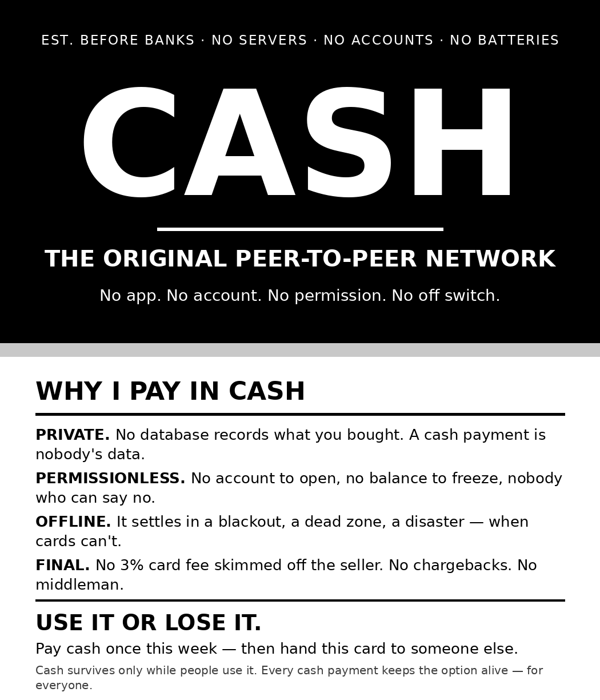

# CASH — the original peer-to-peer network

A black & white business-card handout (3.5 × 2 in, front + back) to give people
together with your cash. Entry for
[poidh bounty #1510](https://poidh.xyz/base/bounty/1510) — "Create business card
sized handout on the benefits of using/accepting cash."

## The card

**FRONT (black)**
"EST. BEFORE BANKS · NO SERVERS · NO ACCOUNTS · NO BATTERIES"
CASH — THE ORIGINAL PEER-TO-PEER NETWORK
"No app. No account. No permission. No off switch."

**BACK (white)** — WHY I PAY IN CASH

- **PRIVATE.** No database records what you bought. A cash payment is nobody's data.
- **PERMISSIONLESS.** No account to open, no balance to freeze, nobody who can say no.
- **OFFLINE.** It settles in a blackout, a dead zone, a disaster — when cards can't.
- **FINAL.** No 3% card fee skimmed off the seller. No chargebacks. No middleman.

USE IT OR LOSE IT. Pay cash once this week — then hand this card to someone else.
Cash survives only while people use it. Every cash payment keeps the option
alive — for everyone.

## Files

| File | What it is |
|---|---|
| `cash-card-both-sides.png` | Front + back in one image (the claim proof image) |
| `cash-card-front.png` | Front, 1050×600 px = 3.5″×2″ @ 300 dpi, pure black & white |
| `cash-card-back.png` | Back, 1050×600 px = 3.5″×2″ @ 300 dpi, pure black & white |
| `cash-card-print.pdf` | Print-ready PDF, 2 pages at exactly 3.5×2 in (252×144 pt): front, back |
| `cash-card-10up.pdf` | 10-up US Letter sheet @ 300 dpi (2×5): front, then back mirrored for duplex long-edge printing |
| `cash-card-10up-front.png` / `cash-card-10up-back.png` | The two 10-up sheets as PNGs (2550×3300 px) |

## Printing

- **At a print shop:** send `cash-card-print.pdf` (exact card-size pages) or the
  two single PNGs.
- **At home:** print `cash-card-10up.pdf` double-sided, flip on the long edge —
  each card's back lands behind its front — then cut along the card edges.

## Design notes

The front is deliberately written in the language of the digital-payment era —
cash framed as the original peer-to-peer network — because the people most
likely to have abandoned cash are the ones who respond to exactly those words.
The back keeps the four core points (privacy, no permission, works offline,
settlement finality for the seller) to one plain sentence each, readable in the
five seconds someone glances at a card. The call to action does double duty:
use cash this week, and pass the card itself on with your next cash payment, so
one printed card keeps circulating instead of ending in a bin.
